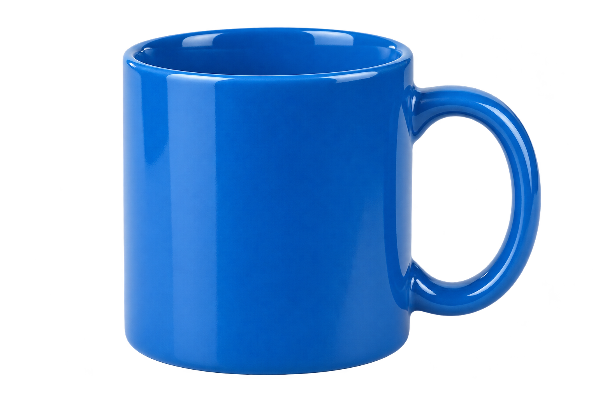
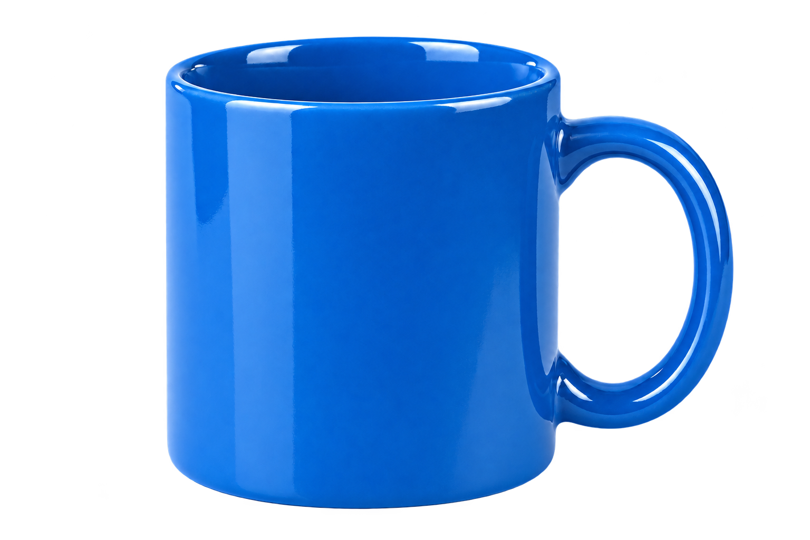

# v1 — implementação e homologação parcial no Mac

16/10/2026. macOS 27.0.1 arm64, Codex CLI 0.163.0, Python isolado 3.12.15. Nenhuma configuração de segurança, aprovação ou autenticação foi modificada. Sem API fallback, SDK OpenAI, instalação global ou publicação de peça.

## Implementado

- Skill descobrível em `.agents/skills/image-production`, composição instrucional com imagegen, papéis de referências/brand kit, prompts por variante e limite de iterações.
- Helper offline `prepare`, `collect`, `review`, `verify`, `status`: snapshots e hashes, cópia byte a byte, nomes versionados, recusa de symlinks/`..`, revisão por sete critérios e estados explícitos. PNG/JPEG/WebP de um frame; dependência Pillow isolada.
- Aprovação exige número de variantes e revisão completa; metadados não aprovam conteúdo. Re-revisões preservam histórico. Schema compacto de resposta final separado do manifesto.
- 14 testes de arquivos, limites de aprovação, adulteração de snapshots/prompts/saídas, recuperação sem fonte original e erros CLI estruturados. Fixtures de teste não são geração AI.

## Resultado real e limitação encontrada

A CLI leu image-production e imagegen, criou um run com o helper, gerou uma imagem integrada, coletou o PNG, criou previews em fundos claro/escuro e retornou resultado válido com `--json --output-schema`. A sessão finalizou com código 0. O resultado estruturado foi validado independentemente com jsonschema. A confirmação de geração inclui arquivo novo realmente decodificado e hash, além do fluxo observado; não se baseia só na declaração final do modelo.

**A imagem não passou no aceite visual.** O revisor da sessão CLI inicialmente marcou approved, mas a inspeção do coordenador encontrou halo azul extenso. A revisão foi corrigida para `needs_revision`; o resultado final antigo da CLI é histórico e não substitui o manifesto atualizado. Isso demonstra um falso positivo do revisor, não falta de transparência binária. A rubrica foi reforçada para verificar névoa externa e interior de alças. Notas inseridas pelo modelo continuam sujeitas a erro; o helper valida completude/consistência, não a verdade da inspeção.

Depois, no desktop, o arquivo local foi carregado com `view_image` e enviado como alvo de edição com `referenced_image_paths`. A ferramenta gerou outro PNG; prepare/collect/review/verify passaram, o original ficou intacto e a referência foi copiada e hasheada. O halo persistiu e houve alteração de reflexos. Resultado: **needs_revision**, sem prometer preservação exata ou recorte pronto. Uma correção foi suficiente para testar a falha; novas gerações não são necessárias para declarar a limitação.

Amostras sintéticas para revisão, sem marca real:

| Inicial — CLI | Edição — desktop |
|---|---|
|  |  |

Prompts, hashes, dimensões, contagens de alfa e revisões em [evidence.json](evidence.json). Saída da suíte em [unit-tests.txt](unit-tests.txt). Logs completos e arquivos intermediários ficam em `work/` ignorado para evitar publicar caminhos do Mac e avisos de integrações.

## Matriz do plano

| ID | Resultado | Evidência / limite |
|---|---|---|
| T01 | Passou nesta sessão local | Pedido sem nome da skill levou à leitura de SKILL.md, contrato e rubrica. Aviso de catálogo saturado persiste; não garante descoberta em outro perfil. |
| T02 | Fluxo técnico passou; visual reprovado | image-production + imagegen em exec; geração, cópia e manifesto observados. |
| T03 | Passou | CLI 0.163.0 gerou arquivo integrado; JSONL + schema final válidos. |
| T04 | Técnico passou; preservação/objetivo parciais | Arquivo local carregado antes de editar; original preservado; halo não removido e reflexos mudaram. |
| T05 | Parcial | Caminho local explícito usado em edição e snapshot/hash conferidos; geração nova baseada só em referência de estilo não ensaiada. |
| T06 | Técnico passou; visual reprovado | Alfa real, arquivo copiado intacto; halo impede aceitar recorte. |
| T07 | Parcial | Contagem, versionamento e duas revisões cobertos por fixture; duas gerações AI independentes de variantes não ensaiadas. |
| T08 | Pendente | Sem campanha real/brand kit aprovado; texto de marketing não homologado. |
| T09 | Parcial | Caneca sintética; sem foto real de produto para garantir identidade. |
| T10 | Pendente | Sem peça institucional real ou identidade fornecida. |
| T11 | Passou nos testes | Ausente/corrompido/animado recusados; nomes ocupados versionados; sem perda de originais. |
| T12 | Passou nos testes | Caminhos absolutos internos, `..`, symlinks de raiz/final/manifesto recusados; não é sandbox contra processo hostil concorrente. |
| T13 | Parcial | Estado blocked/failed e erro local cobertos; indisponibilidade/limite real do gerador não provocados. |
| T14 | Não aplicável à v1 | Nenhum MCP é dependência da skill. Configuração habitual tinha avisos de inicialização/auth; não houve chamada MCP para homologar com schema. |
| T15 | Verificado separadamente | Teste automatizado reabre run sem fontes originais; ensaio em nova sessão CLI registrado em evidence.json após execução. |

## Reproduzir

```sh
uv run --with-requirements requirements-dev.txt python -m unittest discover -s tests -v
```

Com o Skill Creator instalado, executar `quick_validate.py .agents/skills/image-production` num runtime com PyYAML. Resultado observado: `Skill is valid!`. Para repetir geração real, iniciar Codex neste repo, solicitar `$image-production` com brief sintético e saída sob `work/`; conferir ferramentas expostas e o manifesto antes de aceitar a saída. Não publicar stderr bruto nem credenciais. Não é necessário instalar a skill globalmente.

## Limites conhecidos

Um processo por run; sem locking ou recuperação transacional de crash entre candidato e manifesto. Um crash pode deixar arquivo órfão que exige inspeção. Caminhos são verificados no acesso, sem defesa contra troca maliciosa concorrente de diretórios. Raiz de saída é escolha explícita do chamador, não allowlist de sistema. Para corretivas após coletar o número de variantes previsto, abrir outro run mantém histórico e evita ambiguidade de seleção; seleção/arquivamento de candidatos dentro do mesmo run fica para evolução futura.

Não houve benchmark, homologação de impressão, OCR, grader API, teste de custos, avaliação humana de marca ou instalação em outro perfil limpo. Aprovação visual completa continua pendente; esta versão está pronta para revisão de código e uso experimental com inspeção, não para aprovação autônoma de campanhas.
